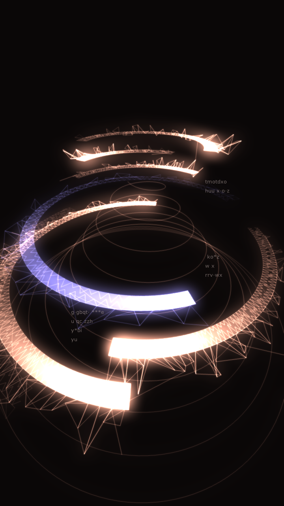

# td-machinarium-spiral

r/TouchDesigner の「[Audiovisual - a Tribute to Machinarium](https://www.reddit.com/r/TouchDesigner/comments/1x5m10v/audiovisual_a_tribute_to_machinarium/)」（u/Yasiin_Miim）の見た目を、動画だけを手がかりに TouchDesigner で組み直したもの。元作品のパッチは公開されていないので、形・光・動きはすべてフレームから推定している。



## 構成

差分は **スクリプトで管理**する（`.toe` は手元のスナップショットで、git には入れない）。

| ファイル | 役割 |
|---|---|
| `scripts/build_spiral.py` | `/project1` に `msp_*` ノード 20 個を組む。何度流しても同じネットワークになる |
| `scripts/spiral_geo.py` | Script SOP のコールバック。帯・網目・ほつれ・ガイド線を毎フレーム生成 |
| `scripts/td_build.py` | ノード構築ヘルパ（td-organic-patterns の写し） |

```
msp_geo_cb (Text DAT) ─► msp_geo/msp_sop (Script SOP) ─► msp_mat (Constant MAT, 加算)
msp_cam ─► msp_render (720x1280, 16bit float)
            ├─ msp_blur_s ─ msp_lvl_s ┐
            ├─ msp_blur_l ─ msp_lvl_l ┼─► msp_glow ─► msp_bgadd ─► msp_tone
            └───────────────────────┘
msp_txt0..2 (HUD) ─► msp_hud ─► msp_out
msp_tick (Execute DAT): 毎フレーム Script SOP を cook、4フレームごとに HUD の文字を入れ替え
```

## 動かし方

TouchDesigner（099.2023.12230 で確認）の Textport で:

```python
P='/path/to/td-machinarium-spiral/scripts/build_spiral.py'
g=dict(globals()); g['__file__']=P; exec(open(P).read(), g); g['build_spiral']()
```

出力は `/project1/msp_out`。手元の Mac で 60fps（Script SOP 約15ms、Render 約1ms）。

## 調整の勘所

- **塗りは先頭だけ**: 帯の塗りは進行方向の先頭付近だけにし、残りは網目（内縁・ゆらぐ中段・外縁の3列）で見せる。塗りが長いと、手前に来た帯がのっぺりした板になる
- **1.0 を超える色**: 点色 Cd に 1.0 超の値を入れ、Render TOP を 16bit float にする。大小2つのブラーを足すと白い芯が残る
- **加算合成**: Constant MAT を `srcblend=one / destblend=one`、深度テストなし。網が重なるほど明るい
- **カメラ**: 回転角に緩い揺らぎ、距離と高さに寄り引き（`CAM_A` / `CAM_D`）
- Script SOP で `pointAttribs.create('Cd', 既定値)` はエラー（標準属性に既定値は渡せない）。`create('Cd')` にする
- Text TOP の位置は揃えの基準（左上）からのピクセルずれ

## 今後

- 音反応（低域で輪の開閉、音量でブルーム）
