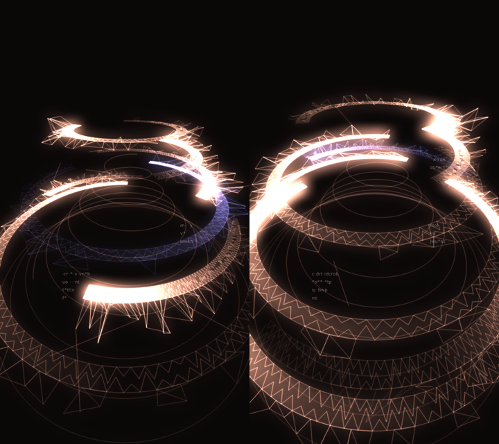

# td-machinarium-spiral

r/TouchDesigner の「[Audiovisual - a Tribute to Machinarium](https://www.reddit.com/r/TouchDesigner/comments/1x5m10v/audiovisual_a_tribute_to_machinarium/)」（u/Yasiin_Miim）の見た目を、動画だけを手がかりに TouchDesigner で組み直したもの。元作品のパッチは公開されていないので、形・光・動きはすべてフレームから推定している。


## 構成

差分は **スクリプトで管理**する（`.toe` は手元のスナップショットで、git には入れない）。

| ファイル | 役割 |
|---|---|
| `scripts/build_spiral.py` | `/project1` に `msp_*` ノード 20 個を組む。何度流しても同じネットワークになる |
| `scripts/build_audio.py` | 音反応（`msp_aud*` / `msp_drive`）。`build_spiral` の後に実行 |
| `scripts/spiral_geo.py` | Script SOP のコールバック。帯・網目・ほつれ・ガイド線を毎フレーム生成 |
| `scripts/td_build.py` | ノード構築ヘルパ（td-organic-patterns の写し） |

```
msp_geo_cb (Text DAT) ─► msp_geo/msp_sop (Script SOP) ─► msp_mat (Constant MAT, 加算)
msp_cam ─► msp_render (720x1280, 16bit float)
            ├─ msp_blur_s ─ msp_lvl_s ┐
            ├─ msp_blur_l ─ msp_lvl_l ┼─► msp_glow ─► msp_bgadd ─► msp_tone
            └───────────────────────┘
msp_txt0..2 (HUD) ─► msp_hud ─► msp_out
msp_tick (Execute DAT): 毎フレーム Script SOP を cook、4フレームごとに HUD の文字を入れ替え
```

## 動かし方

TouchDesigner（099.2023.12230 で確認）の Textport で:

```python
P='/path/to/td-machinarium-spiral/scripts/build_spiral.py'
g=dict(globals()); g['__file__']=P; exec(open(P).read(), g); g['build_spiral']()

# 音反応（build_spiral の後。build_spiral を流し直すと msp_* ごと消えるので、こちらも再実行）
P='/path/to/td-machinarium-spiral/scripts/build_audio.py'
g=dict(globals()); g['__file__']=P; exec(open(P).read(), g)
g['build_audio']()                                  # 既定の音声入力
g['build_audio'](device='BlackHole2ch_UID')         # Ableton 等を BlackHole 経由で
g['build_audio'](audio_file='/path/to/song.mp3')    # ファイルをループ再生
```

出力は `/project1/msp_out`。手元の Mac で約 60fps（音反応込みで Script SOP 約16ms、Render 約1ms）。Script SOP が 1 フレームの予算（16.7ms）ぎりぎりなので、形を増やすなら `_ribbon` の分割数 `n` を減らす。

## 音反応



| 帯域 | 映像 |
|---|---|
| 低域 | 下の大きい輪ほど強く、弧が開いて先頭が明るくなる。大きいブラーも膨らむ |
| 高域 | 上の小さい輪ほど強く同じ反応。三角形のほつれが外へ広がる |
| 中域 | 回転の速さ（`1 + 0.8×中域` を Speed CHOP で積分した時刻を使う） |

- 各帯域は「今の値 ÷ (直近6秒平均×2 + 下駄)」の自動ゲインで 0〜1.5 にそろえる（曲ごとの音量差を吸収）
- Audio Spectrum は `frequencylog=0`、Trim は `relative='abs'`。既定のままだと低中高がほぼ同じ値になる
- 回転の速さを `absTime × 係数` で変えると、係数が変わった瞬間に位置が飛ぶ。速さを積分した時刻を使う
- ハウスのデモ曲で 478 フレーム計測: 低域 p5=0.07 / p50=0.39 / p95=1.5。キックごとに 0.1 前後と 1.5 を往復する

## 調整の勘所

- **塗りは先頭だけ**: 帯の塗りは進行方向の先頭付近だけにし、残りは網目（内縁・ゆらぐ中段・外縁の3列）で見せる。塗りが長いと、手前に来た帯がのっぺりした板になる
- **1.0 を超える色**: 点色 Cd に 1.0 超の値を入れ、Render TOP を 16bit float にする。大小2つのブラーを足すと白い芯が残る
- **加算合成**: Constant MAT を `srcblend=one / destblend=one`、深度テストなし。網が重なるほど明るい
- **カメラ**: 回転角に緩い揺らぎ、距離と高さに寄り引き（`CAM_A` / `CAM_D`）
- Script SOP で `pointAttribs.create('Cd', 既定値)` はエラー（標準属性に既定値は渡せない）。`create('Cd')` にする
- Text TOP の位置は揃えの基準（左上）からのピクセルずれ

## 今後

- 実曲（Floex 系の静かな曲、自作曲）での反応量の調整
- 録画（Movie File Out）
